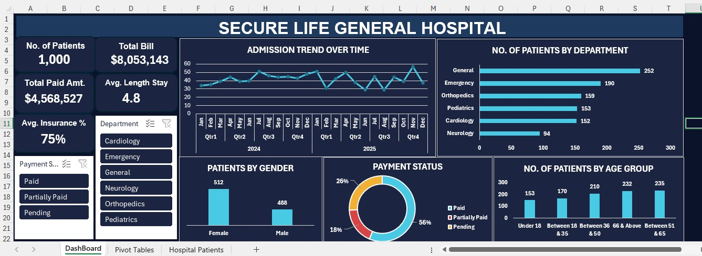

# SECURE LIFE GENERAL HOSPITAL – PATIENTS DATA ANALYSIS

##  Introduction

This project focuses on analysing hospital patient data to understand patient demographics, hospital admissions, departmental performance, billing information, insurance coverage and payment status.

The analysis was carried out using Microsoft Excel, applying data cleaning, calculated columns, PivotTables, data analysis and interactive visualisations to transform raw hospital data into meaningful insights.
The project was completed as part of the FadaQa Scholarship Programme (FSP 2.0).

## About the Dataset

The dataset contains 1,000 hospital patient records and includes information such as:
1. Patient ID and patient name
2. Age and gender
3. Admission and discharge dates
4. Hospital department  
5. Diagnosis
6. Total bill amount
7. Insurance coverage percentage
8. Payment status

Additional calculated columns were created to support the analysis:
1. Estimated Insurance Coverage Amount
2. Patient's Responsibility Amount
3. Length of Stay
4. Age Category 
5. Paid Amount

## Problem Statement

Hospitals generate large volumes of patient and financial data, but without proper analysis, it can be difficult to understand patient distribution, admission trends, departmental workload, billing patterns and payment status.

The objective of this project is to analyze hospital patient records to identify meaningful patterns, evaluate key performance indicators and provide data-driven recommendations that can support better hospital administration and decision-making.

## Tools and Methodology

Tool Used: Microsoft Excel

The following techniques were applied:

1. Data inspection and cleaning.
2. Conversion of the dataset into an Excel Table.
3. Creation of calculated columns using Excel formulas.
4. Development of PivotTables for summarizing data.
5. Calculation of Key Performance Indicators (KPIs).
6. Creation of charts and an interactive dashboard.
7. Interpretation of findings and development of recommendations.

## Dashboard Visualization

The dashboard presents the hospital's performance through the following visualizations:
1. Total number of patients.
2. Total hospital bill amount.
3. Estimated paid amount.
4. Average length of hospital stay.
5. Average insurance coverage percentage.
6. Admission trends over time.
7. Number of patients by department.
8. Patient distribution by age group.
9. Payment status distribution.
10. Patient distribution by gender.

## Key Insights

The analysis revealed the following findings:

1. **Patient Volume**: The hospital recorded 1,000 patient records.
2. **Hospital Billing**: The total bill amount was approximately $8,053,143.
3. **Departmental Distribution**: The General Department recorded the highest number of patients (252), while Neurology recorded the lowest (94).
4. **Gender Distribution**: Female patients accounted for 512 records, compared with 488 male patients.
5. **Payment Status**: Approximately 57% of patients were classified as fully paid, 26% as pending and 17% as partially paid.
6. **Length of Stay**: The average hospital stay was approximately 4.8 days.
7. **Insurance Coverage**: The average recorded insurance coverage percentage was approximately 75%.

## Recommendations

Based on the findings, the following recommendations are proposed:

1. The hospital should review departmental staffing and resource allocation, particularly in departments with higher patient volumes.
2. Management should strengthen payment monitoring and follow-up procedures to reduce pending payments.
3. The hospital should improve its billing and insurance documentation processes.
4. Admission trends should be monitored regularly to support effective planning and resource management.
5. Patient demographic information should be used to support appropriate healthcare planning and service delivery.

## Conclusion

This project demonstrates how Microsoft Excel can be used to transform raw hospital data into meaningful information through data cleaning, calculations, PivotTables and vizualisation.

The resulting dashboard provides an overview of patient demographics, admissions, departmental distribution, billing and payment patterns.

The analysis highlights the importance of data-driven decision-making in improving hospital administration, financial monitoring and operational planning.

## Project: Hospital Patients Data Analysis

## Programme: FadaQa Scholarship Programme (FSP 2.0)

## Tool: Microsoft Excel

### Author: Rukayat Olasumbo Abdulraheem

